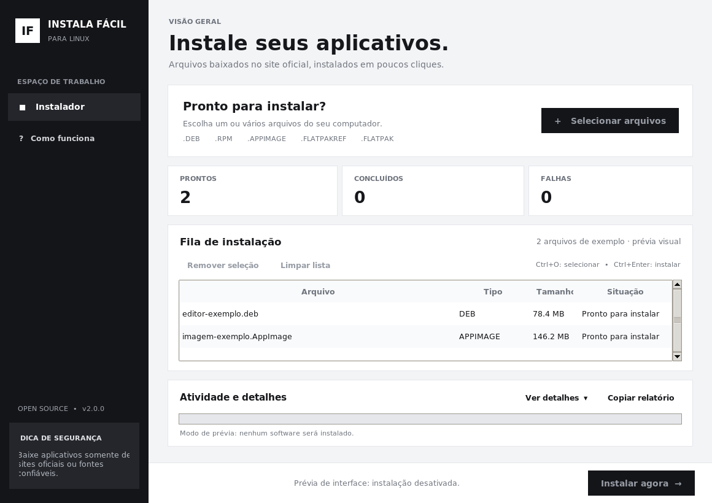

<div align="center">


# Instala Fácil

**Instale aplicativos no Linux com uma interface gráfica. Sem decorar comandos.**


</div>

## O projeto

O **Instala Fácil** é um instalador gráfico open source para Linux. A ideia é simples: quando você baixa um programa pelo site oficial, pode selecionar o arquivo no Instala Fácil e instalá-lo usando botões, sem abrir o terminal para cada aplicativo.

A versão **2.1** apresenta um visual renovado, fila de instalações, barras de progresso, relatório de falhas e instalação guiada com confirmação. Os arquivos **não** são enviados a um servidor; tudo acontece localmente.

## Veja a interface



*Captura da versão 2.0, anterior à atualização visual 2.1.*

## Como instalar no Ubuntu / Linux Mint / Debian

### Opção A — pacote `.deb` (recomendado)

1. [Baixe o Instala Fácil 2.1.0 (.deb) na página de Releases](https://github.com/pizzatto/instala-facil/releases). Caso a versão ainda esteja em processamento, consulte [Actions](https://github.com/pizzatto/instala-facil/actions) ou construa o pacote pela opção B. Confira o SHA-256 publicado com a versão.
2. Abra o arquivo com dois cliques no gerenciador de pacotes, **ou** execute uma única vez:

```bash
cd ~/Downloads
sudo apt install ./instala-facil_2.1.0_all.deb
```

3. Abra **Instala Fácil** no menu de aplicativos.

Se sua pasta de downloads for `~/Baixados`, substitua o caminho acima.

### Opção B — executar o código-fonte

```bash
git clone https://github.com/pizzatto/instala-facil.git
cd instala-facil
sudo apt install python3 python3-tk pkexec
python3 src/main.py
```

Para construir seu próprio `.deb`:

```bash
./packaging/build_deb.sh
sudo apt install ./dist/instala-facil_2.1.0_all.deb
```

> **Importante:** as dependências acima são instaladas uma vez para configurar o aplicativo. O objetivo é evitar terminal nas instalações seguintes.

## Como usar

1. Baixe o instalador do programa em seu **site oficial**.
2. Abra o Instala Fácil e clique em **Selecionar arquivos**.
3. Escolha um ou mais arquivos compatíveis. Selecione linhas e clique em **Remover da fila** (ou Delete) para excluir da lista, sem apagar os arquivos originais.
4. Clique em **Revisar e instalar** e confirme os arquivos; o status muda de **Pronto para instalar** para **Preparando…** e **Instalando…**.
5. Para DEB/RPM, autorize uma vez por lote do mesmo tipo, quando solicitado pelo Linux. AppImage e Flatpak de usuário não exigem senha administrativa. Não são concedidos privilégios permanentes.
6. Em caso de erro, escolha **Ver detalhes**, **Copiar relatório** ou **Tentar novamente**. O log de falhas fica em `~/.local/state/instala-facil/erros.log` (ou XDG_STATE_HOME). Se um lote falhar, alguns pacotes podem ter sido instalados: confira o relatório antes de repetir.

### Abrir diretamente um instalador baixado

Após instalar o novo .deb, clique com o botão direito em um arquivo compatível e escolha **Abrir com → Instala Fácil**. O arquivo entra na fila sem iniciar sozinho. A opção depende do ambiente gráfico e pode exigir reabrir o gerenciador de arquivos. O aplicativo padrão não é alterado.

**Atalhos:** `Ctrl+O` (adicionar arquivos), `Ctrl+Enter` (instalar), `Delete` (remover selecionados).

## Formatos suportados

| Arquivo | Distribuições / requisitos | Método de instalação |
|---|---|---|
| `.deb` | Debian, Ubuntu, Mint e derivados com APT e `pkexec` | `apt-get` com autorização gráfica |
| `.rpm` | Fedora/openSUSE com DNF ou Zypper e `pkexec` | Gerenciador RPM com autorização gráfica |
| `.AppImage` | Linux com suporte ao executável AppImage | Copia para `~/.local/share/instala-facil/appimages` e cria atalho |
| `.flatpakref` | Sistema com Flatpak instalado | `flatpak install --user --from` |
| `.flatpak` / `.flatpakbundle` | Sistema com Flatpak instalado | `flatpak install --user --bundle` |

**Limitações:** Não instala automaticamente arquivos `.zip`, `.tar.gz`, `.sh`, `.exe`, Snap ou scripts aleatórios. A primeira distribuição testada para empacotamento é Ubuntu/Debian; o suporte RPM depende das ferramentas disponíveis no sistema. O instalador não fornece sandbox adicional e **não verifica assinaturas criptográficas** dos pacotes: a confiança na origem do download continua essencial. AppImage pode exigir bibliotecas adicionais do sistema, dependendo do aplicativo.

## Diagnóstico e problemas comuns

```bash
instala-facil --version
instala-facil --diagnostico
```

- **Instalador não abre:** execute `instala-facil --diagnostico`; confirme que `python3-tk` está instalado e que a sessão tem suporte gráfico.
- **Autorização não aparece:** verifique a instalação de `pkexec` e se sua sessão possui um agente PolicyKit ativo.
- **Aplicativo não instala:** clique em **Ver detalhes** e copie o relatório. Dependências de pacotes e erros do APT são repassados na interface.
- **Fica em “Aguardando”:** esta palavra era usada em versões antigas. Verifique `instala-facil --version`: na v2.1 o botão **Revisar e instalar** inicia a fila imediatamente e mostra progresso ou erro.
- **Flatpak não encontrado:** instale Flatpak conforme as orientações oficiais da sua distribuição.

Saiba mais no [Guia de uso e solução de problemas](docs/GUIA.md).

Quer colocar este projeto no seu próprio GitHub? Veja [Como publicar um repositório público com release](docs/PUBLICAR_GITHUB.md).

## Para desenvolvedores

O projeto é escrito em **Python 3 com Tkinter** e usa ferramentas já presentes no sistema. Sem chamadas de shell com `shell=True` para instalar pacotes. A interface utiliza uma thread para instalar e uma fila de eventos para atualizar os componentes sem bloquear a janela.

```text
instala-facil/
├── src/
│   ├── main.py             # Interface, fila, progresso e diagnóstico
│   └── core.py             # Detecção de formatos e instaladores
├── assets/
│   ├── instala-facil.svg
│   └── screenshots/
├── packaging/
│   ├── build_deb.sh        # Constrói o pacote .deb
│   └── instala-facil.desktop
├── tests/                  # Testes sem instalar apps de verdade
├── .github/workflows/      # Testes CI no Linux
├── docs/
├── CONTRIBUTING.md
├── SECURITY.md
└── LICENSE                 # MIT
```

Rodar testes:

```bash
python3 -m unittest discover -s tests -v
xvfb-run -a python3 src/main.py --smoke-test  # teste da interface sem desktop real
```

## Contribua

Achou um problema? Abra uma **Issue** com sua distribuição, versão e mensagens relevantes (sem senhas ou dados pessoais). Sugestões e pull requests são bem-vindos. Consulte [CONTRIBUTING.md](CONTRIBUTING.md) e [SECURITY.md](SECURITY.md).

## Segurança

O Instala Fácil apenas organiza instaladores locais e pede autorização quando necessário. **Não execute instaladores desconhecidos.** Em caso de problemas de segurança, siga [SECURITY.md](SECURITY.md) e evite publicar detalhes exploráveis em uma Issue.

## Licença

Distribuído sob a [licença MIT](LICENSE). Projeto comunitário, gratuito e de código aberto.

---

**English:** Instala Fácil is a Portuguese graphical Linux app installer. Select an official `.deb`, `.rpm`, `.AppImage`, or Flatpak file, confirm, and follow progress without typing installation commands every time. See the instructions above; contributions are welcome.
